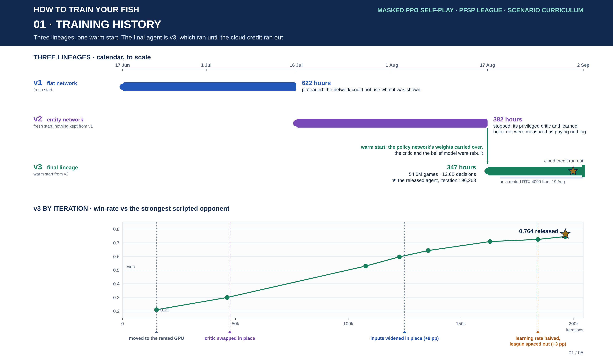
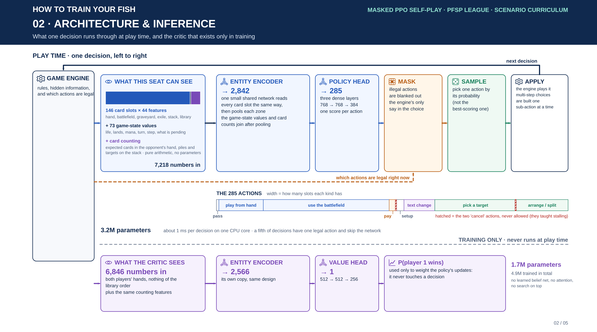
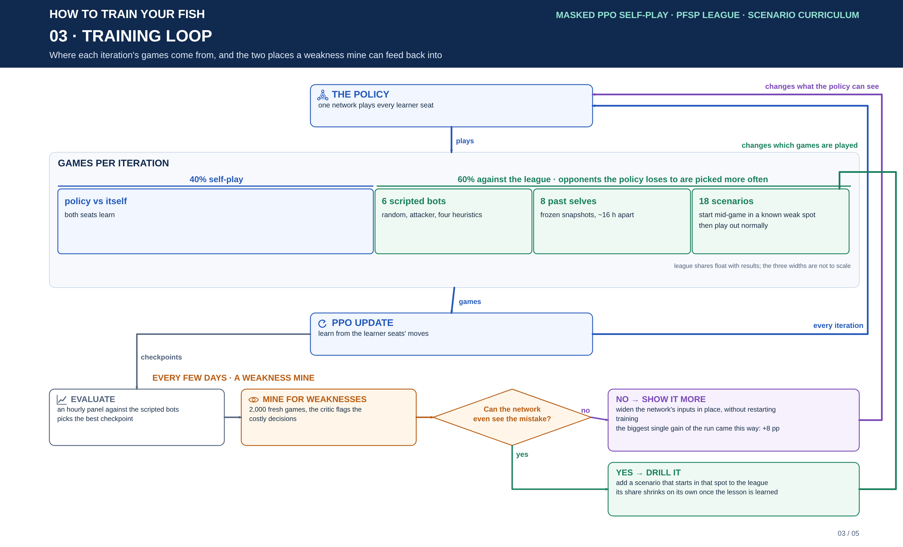
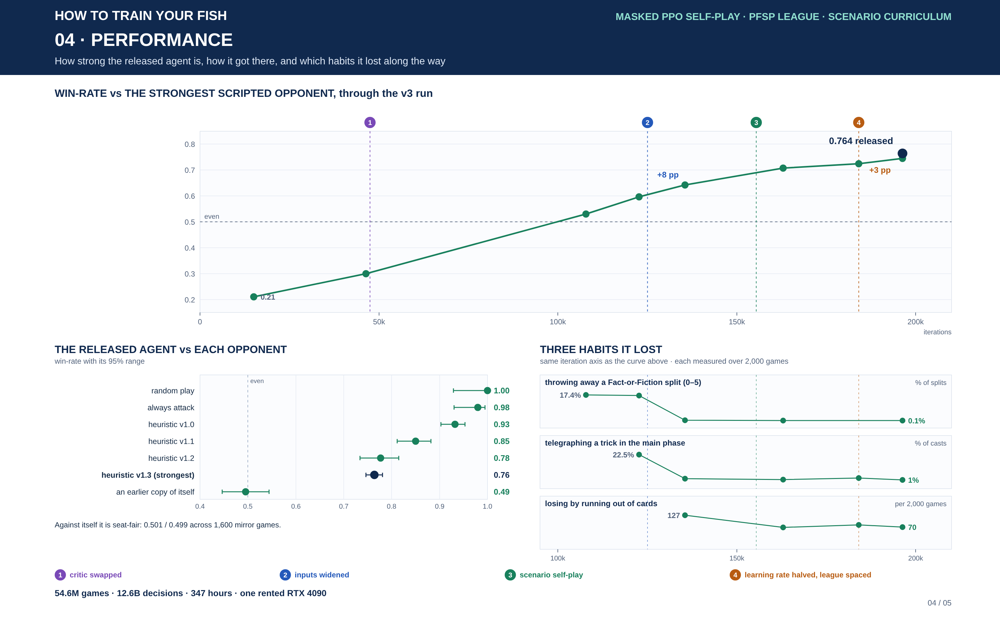
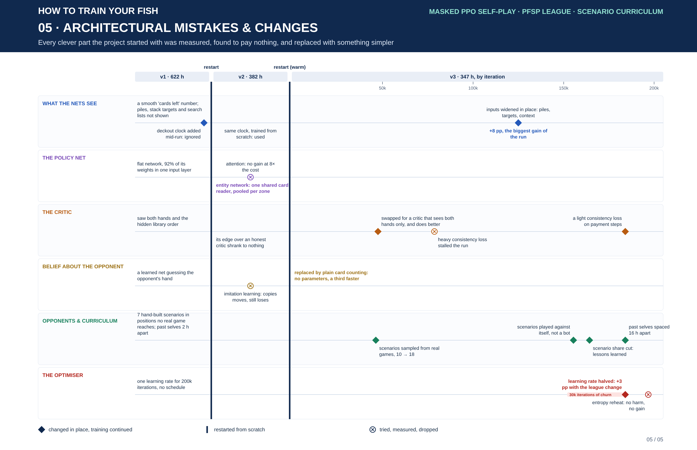

# How To Train Your Fish: masked PPO self-play for Forgetful Fish

Source and training record for an adversarial self-play agent for **Forgetful Fish** (Dandân), a two-player Magic: the Gathering format in which both players draw from one shared, hidden library. The agent is a single masked-PPO policy that plays both seats, trained against a prioritised league of scripted opponents, frozen past selves and constructed scenarios. The final agent beats the strongest scripted player in the project, heuristic v1.3, in **76.4% of games** (n = 2,400) and the long-standing v1.0 anchor in 93.2%.

Three properties make the game a hard learning problem rather than a toy:

- **Asymmetric, divergent knowledge of a shared secret.** One 80-card library serves both players. Brainstorm, Ponder and Halimar Depths let a player learn and rearrange the top of a deck the opponent also draws from, so beliefs about the same hidden object diverge.
- **Card identity is mutable.** Mind Bend, Crystal Spray and Vision Charm rewrite type lines and oracle text mid-game. Dandân is sacrificed when its controller has no Islands, so turning an Island into a Swamp is removal. The observation encodes the rewritten card, not the printed one.
- **The deckout race is the real game.** Every extra draw advances a shared clock toward a loss condition, and parity decides who hits the empty library first.

| Component | Final state |
| --- | --- |
| **Actor** | Entity encoder (shared card encoder, card_dim 128) over 146 card rows, head 768 / 768 / 384, masked flat action space of 285 actions. 2.68M parameters before four in-place input widenings, 3.22M after |
| **Critic** | Same entity encoder on a *hands view* (public state plus both hands, no library), head 512 / 512 / 256 → P(p1 wins), deckout-parity auxiliary head (0.1), temporal-consistency penalty λ 25 on deterministic pay steps. 1.75M parameters, training only |
| **Belief** | Analytic *bookkeeper*: expected opponent-hand counts per card name from the viewer's own view, zero parameters. Replaced a learned Poisson hand-guesser |
| **Opponents** | PFSP hard-mode league: 6 scripted anchors (random, attacker, heuristic v1.0 – v1.3), 8 past-self snapshots spaced every 8th report, 18 constructed scenarios at boost 0.5 with scenario self-play 0.6 |
| **Optimiser** | Adam 1.5e-4 (halved from 3e-4 at iteration 184k), minibatch 1,024, entropy floor 0.008, 4 PPO epochs, clip 0.2 |

Scale of the final (v3) lineage: **54.6M games, 12.6B decisions, 346.95 h** of training, iterations 0 → 204,225, the last ~14 days on a rented RTX 4090 at 103–181k games per hour. Two earlier lineages, v1 (622 h) and v2 (382 h), preceded it on local hardware. The release agent is `checkpoints-v3/best.pt` at iteration 196,263.

**Figures**

1. [Training history](#1-training-history) — three lineages on a calendar, plus v3 by iteration
2. [Architecture and inference](#2-architecture-and-inference)
3. [Training loop and opponents](#3-training-loop-and-opponents)
4. [Performance](#4-performance)
5. [Architectural mistakes and changes](#5-architectural-mistakes-and-changes)

## Contents

- [1. Training history](#1-training-history)
- [2. Architecture and inference](#2-architecture-and-inference)
- [3. Training loop and opponents](#3-training-loop-and-opponents)
- [4. Performance](#4-performance)
- [5. Architectural mistakes and changes](#5-architectural-mistakes-and-changes)
- [6. Running it](#6-running-it)
- [Numbers that were not recovered](#numbers-that-were-not-recovered)

---

## 1. Training history

*Three lineages on a calendar, to scale, with the one warm start; below, the final lineage by iteration with the four changes that mattered.*

Three lineages were trained, each preserved on disk. Only the actor's weights crossed from v2 to v3; nothing crossed from v1 to v2.

| Lineage | Dates (2026) | Hours | What changed | How it ended |
| --- | --- | --- | --- | --- |
| **v1 "flat"** (`checkpoints/`) | 06-17 → 07-16 | 622 | Flat MLP actor (1.81M parameters, 92% in the input projection), privileged critic on the full hidden state, learned hand-guesser, public estimator. ODROID 8-core board plus a PC relay | Plateaued at h1.0 0.375 / h1.2 0.225. A deckout-clock feature added in place at 592 h was provably ignored (ablation Δ 0.000). A seat asymmetry (0.37 / 0.63 in mirror play) was traced to engine bugs, not the policy |
| **v2 "entity"** (`checkpoints-v2/`) | 07-16 → 08-17 | 382 | Fresh restart with an entity actor: shared card encoder, card_dim 128, head 768 / 768 / 384 (2,677,021 parameters). PC only, 16 workers × 32 games per iteration from 08-07 | Two audits on 08-17 found both privileged-information consumers no longer paying for themselves: the god-view critic's Brier edge over a public critic had fallen to 0.202 vs 0.197, and the learned guesser's edge over arithmetic was 0.026 nats and decaying |
| **v3** (`checkpoints-v3/`) | 08-14 → 09-02 | 346.95 | Actor warm-started from v2's best checkpoint; analytic bookkeeper belief; public critic, then a hands-view critic swapped in place at iteration 47,538; deckout-parity auxiliary head; guided text-change actions. Moved to a Vast.ai RTX 4090 at iteration ≈15k | Training ended when the cloud credit ran out, mid-way through an unread entropy-reheat cycle. The last checkpoint to pass the maximin best-gate was 196,263 |

### 1.1 The v3 run, milestone by milestone

Win-rates are against heuristic v1.3 unless stated; "mine" means a 2,000-game fresh-seed evaluation, "pooled" a block-aggregated training harvest.

| Iteration | Date | Change | h1.3 |
| --- | --- | --- | --- |
| 0 | 08-14 / 17 | v3 launch: bookkeeper, public critic, deckout aux, guided text-change, warm start; actor frozen for 1,500 iterations with a KL-to-teacher term | — (no iteration-0 eval was run) |
| ~15k | 08-19 | Moved to the Vast.ai box, 103k games/h | 0.21 |
| 46,343 | 08-21 | Envelope curriculum: ten constructed scenarios sampled from real-game percentile bands, natural terminators | ~0.3 |
| 47,538 | 08-21 | Hands-view critic swapped in place; critic trains one epoch per update from ≈52.6k | |
| ≈64k | 08-22 | `obs_counts` (+22 inputs) widened in place; throughput pushed to 181k games/h | |
| ≈78.7k | 08-23 | A consistency penalty over cast / pass pairs stalled the climb (0.413 → 0.39); boxed at 0, critic transplanted back | 0.41 |
| ~100k | 08-24 | `fof_split`, `fof_pick`, `opening_race` scenarios | ~0.55 (mine 0.530 at 107.8k) |
| 123k – 127k | 08-26 | Observability packs widened in place: `obs_split` (+64), `obs_ctx` (+133), `obs_tgt` (+482) | mine 0.596 at 122.7k |
| 135,492 | 08-27 | Plateau broken by the packs; degenerate 0-5 splits 0.3% | mine 0.643 |
| 155,430 | 08-28 | Scenario self-play 0.6 (both seats the policy inside scenarios) | pooled ~0.71 |
| ≈164.3k | 08-29 | Scenario boost 3 → 0.5; scenario share of games 44% → 18% | mine 0.708 |
| 152k – 184k | | Plateau at pooled 0.71 – 0.72: gradient-noise-limited churn, LR never decayed, past-self ring spanning ~2 h | |
| 184,058 | 08-31 | LR 3e-4 → 1.5e-4, league snapshot every 8th report, consistency λ 10 | 0.723 → 0.757 (+3.4pp step) |
| **196,263** | **09-01** | **Last new best: the final agent** | **0.764 ± 0.009 (n = 2,400)** |
| 196,735 | 09-01 | Entropy reheat (peak 0.012) and λ 25; cycle 1 sub-therapeutic | |
| 203,867 | 09-02 | Reheat escalated to peak 0.016; cut short, unread | |
| 204,225 | 09-02 | End of training. `latest.pt` benches 0.665 (n = 200) mid-reheat; `best.pt` is the release agent | ~0.75 |

### 1.2 Counting convention

- **Iteration**: one PPO update over `games_per_iter` games. The regime moved from 8 games per iteration (v1) to 32 (PC, from 08-07) to 360 (cloud box, from ≈74k), so iteration counts are not comparable across regimes and reset per lineage.
- **Game**: one episode, whether a full game, a league game or a scenario start. Mirror games count once; draws and truncations are included.
- **Decision**: one buffered PPO transition, including compound-decision sub-steps and forced single-legal steps. Mirror games contribute both seats; league games only the learner's seat. 12.6B / 54.6M ≈ 231 decisions per game.
- The totals above are sums of live report rows for v3 and exclude evaluation panels and mines. No game or decision totals were recorded for v1 or v2.
- **Win-rate**: learner on the play against heuristics; draws and truncations count in the denominator and only strict wins in the numerator. `best.pt` is the maximin over the scripted anchors (from 08-07; v1.0-only before).

## 2. Architecture and inference

*What one decision runs through at play time (top), and the critic that only exists in training (bottom). Exact dimensions are in the text below.*

**Observation.** The engine is run as a two-human game and pauses at every decision; the environment treats each learning agent as one of those seats, so the rules core is never edited. The observation is built from `state.current_view`, which enforces hidden-information legality. It is a flat vector of 6,497 floats: 146 card rows × 44 features (own hand 12, opponent hand 12, own battlefield 34, opponent battlefield 34, graveyard 32, exile 8, stack 6, known library 8) plus 73 global features (life, hand and land counts, mana pool, turn, step, pending decision type, combat, payment state, builder progress and a 3-bit deckout clock). Each card row carries a name one-hot over the 20-card vocabulary with an unknown bit, type flags, the *effective* basic land type read from the rewritten type line, the basic types named in the current oracle text, a text-altered flag, power / toughness / damage / counters, tapped, summoning-sick, controller and a known bit.

**Belief tail.** A 721-float tail is appended by the analytic bookkeeper: 20 expected opponent-hand counts per name (`known + (hand size − Σknown) · remaining / Σremaining`), 22 remaining-per-name counts, 64 Fact-or-Fiction split features, 133 context features (stack targets, search eligibility, builder arrangement, blocker focus) and 482 target-slot features. It has no parameters and is a pure function of the viewer's own view, so nothing needs freezing for past selves. Actor input: 7,218.

**Networks.** The entity encoder applies one shared card encoder (name linear 20 → 128 plus a feature MLP 24 → 128 → 128, LayerNorm, ReLU) to every row, adds zone and position embeddings, and pools masked mean ⊕ max per zone into 2,048 features ⊕ 794 globals = 2,842. The actor head is 2,842 → 768 → 768 → 384 → 285 logits (Linear + LayerNorm + ReLU × 3). There is no attention in the final networks; an attention variant was implemented and shelved with no measured win at 8.6× the CPU cost. The critic uses the same encoder on a 138-row hands view (both hands visible, no library rows) plus 742 context features, head 512 / 512 / 256 → a logit for P(p1 wins), with a deckout-parity auxiliary head. Parameter counts from instantiating the final configuration: actor 3,215,389, critic 1,746,184. The actor was 2,677,021 before four zero-initialised input widenings, which is the figure the run's own reports quote.

**Action space.** A single `Discrete(285)` index per decision: pass and end-turn, play / play-alternate / cycle for 12 hand slots, 34 tap-land and 68 activate slots, five mana allocations, play-order, mulligan and FoF-choose pairs, a 5 × 5 text-change block, 64 single-pick slots, pick-none, two 20-slot pick lists for compound builders, commit and shuffle. Cards are addressed by zone-slot index and resolved to engine objects at apply time. Illegal logits are set to −1e9; every unmasked action is guaranteed to be accepted by the engine. Cancel actions exist but are never offered (an anti-stall measure), casts are affordability-gated, and text-change is *guided* to two live options, EFFECT and NO-OP. Combinatorial decisions (scry, reorder, put-back, discard, attackers, blockers, FoF split) are built one sub-step at a time by an environment-side builder that emits its own mask per step and calls the engine only once the choice is well-formed. Each sub-step is one PPO transition.

**Inference.** Nothing sits on top of the policy network: no search, no rollouts, no rule-based repair. Per decision the engine pauses on a pending choice, the perspective view and bookkeeper tail are encoded, the mask is computed, one actor forward runs (about 1 ms on CPU at batch 1, ~14 MB of fp32 weights), and the action is **sampled** from the masked distribution. Greedy argmax was measured to be degenerate: a high-entropy masked policy deterministically repeats a no-op pass and loses. Decisions with exactly one legal action (20–25% of them) are taken without a forward. The critic is never used at play time.

**Training.** Masked PPO with clip 0.2, 4 epochs, minibatch 1,024, γ 0.997 and GAE λ 0.95 computed per (game, seat) segment; terminal ±1 reward and nothing else. One shared policy plays both seats, with a single zero-sum sign convention V(p1) ≡ −V(p2). The critic is trained with BCE against the terminal winner for one epoch per update (four epochs over-fit: in-batch Brier 0.03–0.05 against 0.21–0.23 held out) plus a temporal-consistency penalty (σV(s) − σV(s′))² over deterministic pay-step pairs. Critic values are filled in one batched forward after collection.

## 3. Training loop and opponents

*The every-iteration loop, where each iteration's games come from, and the two ways a weakness mine feeds back into it.*

Each iteration's games come from two sources. Forty percent are mirror self-play, with both seats played by the current policy and both seats' transitions trained. Sixty percent are league games against one opponent drawn by prioritised fictitious self-play in hard mode (weight ∝ (1 − win-rate)² + 0.05 over a win-rate EMA), with only the learner's seat trained. The league holds six scripted anchors (random, attacker, heuristic v1.0 and the pool-only v1.1, v1.2, v1.3), eight frozen past selves kept every 8th status report (a ring spanning about 16 hours; it was one per report, about 2 hours, until iteration 184k), and 18 constructed scenarios whose weights are multiplied by a boost of 0.5. Scenarios shape only the start state, sampled from the p10–p90 envelope of traced real games, and then run to their natural end with the usual terminal reward. With probability 0.6 the far seat of a scenario is the policy itself; otherwise it is the v1.3 engine seat.

Evaluation runs out of band so it never blocks collection. An hourly panel plays at least 100 games per anchor and rolls `best.pt` by maximin over the anchors. Every ~15k iterations a *weakness mine* plays 2,000 fresh games against v1.3 and 1,600 mirror games, with the critic judging counterfactuals and an analyser battery counting specific errors. The mine's findings drive the two kinds of change the run made: when a frozen skill turned out to be invisible to the credit path (the critic's value exactly flat across a choice), an observation pack was widened into the networks in place; otherwise a constructed scenario was added and later shrunk once the lesson was mined out.

## 4. Performance

*The learning curve, the released agent against every opponent, and three habits that disappeared under the same events.*

### 4.1 Final benchmarks

All numbers were measured fresh on 2026-09-02 on `best.pt` (iteration 196,263), not taken from training-stream telemetry.

| Opponent | Win-rate | n |
| --- | --- | --- |
| random | 1.000 | 50 |
| attacker | 0.980 | 100 |
| heuristic v1.0 (the eval anchor) | 0.932 | 400 |
| heuristic v1.1 | 0.850 | 400 |
| heuristic v1.2 | 0.777 | 400 |
| **heuristic v1.3 (testbench mainline)** | **0.764 ± 0.009** | **2,400** (mine 0.762 / 2,000 + panel 0.775 / 400) |
| frozen self, ~110 iterations older | 0.495 | 400 |

Mirror self-play over 1,600 games: seat split 0.501 / 0.499, on-the-play 0.519, 30.9 mean turns, 20.6% of decided games end by deckout. The resume point `latest.pt` (iteration 204,225) was checkpointed in the middle of an entropy-reheat peak and benches 0.665 (n = 200), a real ~10pp wobble below `best.pt`; it is the right training resume point, not the release agent.

### 4.2 Decision quality

| Metric (vs v1.3, 2,000-game mines) | Earlier | Final |
| --- | --- | --- |
| Decision-level Brier | 0.183 at 107.8k | 0.139 (0.132 at 196k) |
| Degenerate 0-5 Fact-or-Fiction splits | ~20% at 98.5k – 122.7k | 0.1% |
| Removal wasted on lands with a fish available | 3.4% at 135k | 1.0% |
| Catastrophic main-phase telegraphing of a text-changer | 22.5% at 122.7k | 1.0% |
| Losses by deckout per 2,000 games | 127 at 135k | ~70 |
| Day's Undoing blow-up rate / mean value | 19% / −0.018 at 135k | 12.7% at 163k / +0.04 |
| Never-ahead losses (share of losses) | 16.9% at 122.7k | 0.35% |
| Mystical Tutor mean value per cast | −0.042 at 163k | −0.023, still negative |

The mines' largest remaining "blunder" class, passing with castable spells, was adjudicated correct by an outcome-calibration test: at the flagged states the critic read 0.45–0.50 while the agent actually won 0.62–0.65 of them, a +14.7pp judge bias at the end of the run. Of the 0.85 flagged decisions per game that remain, 0.84 are this holding pattern. Mystical Tutor and predict-the-name in the deckout endgame are the last identified skill gaps.

### 4.3 Compute

| Machine | Throughput |
| --- | --- |
| ODROID 8-core, no GPU (v1) | ~205 iterations/h × 8 games |
| PC, i7-14700KF + RTX 3060 (v1 relay, v2) | 22.5k games/h at 16 workers × 32 games per iteration |
| Vast.ai RTX 4090, 128 cores, 120 collect workers (v3) | 103k games/h at arrival; 181k games/h after shared-memory transport and a columnar rollout buffer (502 iterations/h × 360 games) |

Rollout collection is pure Python on CPU; the GPU accelerates the network updates and a batched inference server. v3's mean over the whole lineage works out to ≈157k games/h (derived: 54.6M games / 346.8 h). Total training time across the three lineages was 1,351 h. No cloud cost figure was recorded.

## 5. Architectural mistakes and changes

*Each kind of component: what it started as, what replaced it, and what was tried and dropped. Numbers and evidence are in the table below.*

This section covers design decisions only. Bugs, telemetry traps and operational incidents are recorded in the repository's `FINAL-REPORT.md` and journal but are deliberately left out here.

| Area | Original design | What showed it was wrong or insufficient | Replacement and effect |
| --- | --- | --- | --- |
| **Actor encoder** (v2 restart, 07-16) | Flat MLP over the raw 6,517-vector; 92% of its 1.81M parameters sat in the input projection | A hard plateau on the 622 h v1 run. The entity critic had already won its A/B (Brier 0.261 vs 0.342); the actor head-to-head was ambiguous, so the flip was made on the parameter-shape argument | Entity encoder with one shared card encoder, zone and position embeddings and mean ⊕ max pooling, head 768 / 768 / 384 (2.68M parameters). Throughput was ~1.4× worse, not the 6× feared |
| **Critic inputs** (v3, 08-14 → 08-21) | Privileged "god" view with both hands and the full hidden library order (8,920 inputs), on the argument that a critic never ships | By 08-17 the privileged Brier edge had depreciated to ~0 (0.202 vs 0.197). On 88.7k states a public critic scored 0.190, a hands view 0.183 and the god view 0.188: worse with strictly more information | Public critic at the v3 launch, then a hands-view critic swapped in place at iteration 47,538 behind a 1,500-iteration critic-only freeze and a KL-to-teacher term. A reset to a new lineage was tried the same day and discarded after an hour |
| **Belief model** (v3) | Learned per-seat Poisson hand-guesser (1.74M parameters) concatenated to the actor input | Its edge over arithmetic was 0.026 nats, decaying to ~0.005 and negative with three or more known cards; 77% of its signal was bookkeeping; it cost ~32% of collection time | Analytic bookkeeper, zero parameters, +36% iterations per hour. The on/off win-rate ablation was never run |
| **Observation: credit-path blindness** (iterations 64k, 123k – 127k) | Zone pooling yields presence and fractions, never counts; FoF piles, stack targets, search lists and builder arrangements lived only in engine state | Degenerate 0-5 splits stayed at ~20% across three checkpoints while the critic's value was exactly flat across the five pick toggles (\|dV\| = 0.0000, n = 1,587). Aliasing probes found an opponent's spell at *my fish* and at *my land* bit-identical in the observation | Four packs widened in place: counts (+22), split (+64), context (+133), targets (+482). h1.3 0.56 → 0.643 in one stretch, the single biggest win of the run; 0-5 splits fell to 0.3% |
| **Action space** (v1 → v3) | Reversible toggles and cancel affordances offered to the policy; the full 5 × 5 text-change block open | Reversible actions plus terminal-only reward produced stalling three ways: cancel oscillation, an attacker toggled through 87% of a 6,700-decision game, stranded payments. Text-change pairs were almost all inert or self-harming | Monotone builders, cancel actions withheld, a colour-aware affordability gate, and text-change guided to {EFFECT, NO-OP}. A later audit found the mask contract clean and deliberately rejected the one remaining gap (tapping to float mana at priority) |
| **Deckout clock** (07-14 → v2) | Library size as a smooth `len / 80`, with parity assumed learnable | A trunk probe for the deckout winner read 0.525 against a 0.514 base. A 3-bit clock added in place to the settled flat actor was ignored: ablation Δ 0.000 | The same feature, trained from iteration 0 on the entity actor, was used: deckout-scenario win-rate 0.380 with it, 0.164 zeroed, 0.080 inverted. This became the rule for in-place changes versus restarts |
| **Past-self league spacing** (184,058) | One frozen snapshot per status report in an 8-deep ring | During the 152k – 184k plateau the ring spanned ~2 h: 76% of games were against ≤2 h-old near-clones, the past-self win-rate sat at 0.500 while the KL stayed at 0.013 | Snapshot every 8th report, a ~16 h ring; PFSP then up-weights the older selves that still beat the learner. Part of the +3.4pp step |
| **Scenario far seat** (155,430) | Every scenario put the v1.3 bot on the far seat, the only punisher of self-play-blind habits | At ~0.64–0.70 against v1.3 the scripted seat capped what scenarios could teach and gave only the responder's perspective | Scenario self-play 0.6. It cost a −1.4pp step and halved the slope at the seam, but deckout losses halved (127 → 69 per 2,000) by the next mine |
| **Curriculum shape** (08-21 → 08-29) | Seven hand-built scenarios in corner states (four life, lands exiled), some with proxy terminators; a fixed scenario fraction | Legal states in corners no real game visits; proxy terminators teach the proxy | Envelope sampling from real games with natural terminators, scenarios as PFSP members; 18 live by the end. Boost 3 → 0.5 once the lessons were mined out, since curriculum is scaffolding rather than architecture |
| **Critic objective** (78.7k → 184k → 196.7k) | Pure BCE against the terminal winner; nothing tied the value across deterministic chains such as tap → cast | ±8% value swings across payment steps were pocketed as advantage, invisible to Brier. A TD-mix was neutral at best; a consistency penalty over pairs spanning spell resolution stalled the run (0.413 → 0.39) | Consistency on deterministic pay-step pairs only, λ 10 then 25: critic jump 0.0205 → 0.0094, decision Brier 0.154 → 0.132, hold / cast bias +18.5 → +13.6pp. The best late-run lever |
| **Optimiser schedule** (184,058) | Adam 3e-4 from launch with no decay | The gradient-noise scale saturated (critical batch far above the batch) with KL 0.013 for 30k iterations: noise-limited churn | LR halved to 1.5e-4 and re-asserted on every resume: KL 0.006, clip fraction 0.041, critic accuracy 0.712 → 0.727; part of the +3.4pp step |
| **Exploration** (196,735 → 204k) | Linear entropy anneal to a 0.008 floor; a cosine reheat implemented but off | At 196k optimisation was healthy but the policy was sharpening (entropy 0.41 → 0.37) with per-decision error mass exhausted, a local-optimum profile | A reheat at peak 0.012 was sub-therapeutic (+0.02 nats, no damage, no discovery); peak 0.016 ran half a cycle before the cloud credit ended and was never read |

**Tried and not kept:** the privileged critic and public estimator, the learned hand-guesser, the attention encoder, the critic TD-mix, imitation beyond bootstrap (behaviour cloning from heuristic v1.2 reached ~88% per-decision agreement but only a 0.08–0.1 win-rate against its own teacher, and agreement anti-correlated with win-rate under DAgger), the consistency penalty over cast / pass pairs, and the timid reheat.

**Never tried:** a direct heuristic-v1.3 anchor weight (exposure to v1.3 was about 1.7% of games at the end; the risk is over-fitting to its quirks), a function-preserving in-place actor widen (the actor is only 2.68M parameters), the belief on/off ablation and an iteration-0 evaluation.

**The pattern that held:** change inputs and the critic in place behind a function-identity gate (zero-initialised columns, a remap, and an `old(x) == new(x′)` check) followed by a KL re-arm, and restart the lineage only when the trunk's inputs change. Each lineage reset cost two to three days to re-climb; none of the in-place changes did.

## 6. Running it

Installation, the PettingZoo quickstart, training and resume commands, the out-of-band evaluation panel and the systemd / Windows deployment are in [`docs/RUNNING.md`](docs/RUNNING.md). The final regime is [`deploy/train.args`](deploy/train.args); the lineage resumes from `checkpoints-v3/latest.pt` with `deploy\fishrl-pc.bat`. Design rationale and the telemetry contract are in [`docs/DESIGN.md`](docs/DESIGN.md), the end-of-run record in [`docs/FINAL-REPORT.md`](docs/FINAL-REPORT.md), and the dated decision trail in [`journal/`](journal/).

## Numbers that were not recovered

- Iteration, game and decision totals for v1 and v2, and v2's end-state win-rates against the heuristics. v1's only recorded strength is h1.0 0.375 / h1.2 0.225.
- Which v2 iteration `checkpoints-v2/best.pt` was when it seeded v3.
- The v3 start date is given as 08-14 in the final report's milestone table and 08-17 in the recovered history; the v3 hours as 346.95, 346.8 and 347 in different places.
- The FINAL-REPORT's early milestone win-rates (0.21 at ~15k, ~0.3 at 46k, ~0.55 at 100k, ~0.70 at 155k) carry no sample size; the mines and pooled blocks in the learning curve do.
- The second entropy-reheat cycle (peak 0.016) ran about half a cycle and its kill criterion was never evaluated.
- The checked-in `train.args` lags the last deployed command line: the box's final restart carried the reheat flags, and the journal records `critic_epochs 1` while the checked-in regime does not pin it.
- No cloud cost was recorded; the run ended "by the end of cloud credit".

---

Figures are generated from the scripts in [`docs/figures/sources/`](docs/figures/sources/) (`python3 figNN_*.py` writes the SVG, `node render.js` renders the PNG with a headless Chromium), styled after the [kaggriculture-solution](https://github.com/msdsm/kaggriculture-solution) figures. Sources for every number: `docs/FINAL-REPORT.md`, `docs/DESIGN.md`, `journal/`, `deploy/train.args` and the code under `fishrl/`, at commit `4453495` (2026-09-02). Parameter counts and dimensions were verified by instantiating the final configuration.
